# 🎬 Film Kiralama - Film Rental System (C# & SQL Server)

🇬🇧 **English** · 🇹🇷 [Türkçe](README.tr.md)

A Windows Forms application built with .NET 10 and SQL Server for a film rental shop: customers sign up, browse
the catalog, rent a copy of a film for a number of days and return it; admins manage films, stock, accounts and
every active rental, and late returns are charged a daily late fee. The code is split into Domain, Business, Data
and UI layers; database access uses EF Core, and the database is created, migrated or upgraded automatically on
startup.

> The application's user interface is in Turkish. Screen and button names below are given with their Turkish
> labels followed by an English translation, e.g. "Film Ekle" (Add Film).

---

## 📦 Features

### Film catalog

- ✅ **Catalog** ("Film Kirala", Rent a Film): listed films with poster, title, genre, year, director, daily price
  and average rating; "Yalnızca müsait" (Available only, on by default) keeps the films with a copy on the shelf.
  A film without a copy shows "Stokta yok" (Out of stock) instead of the rent button.
- ✅ **Search** by title ("Film adı", found anywhere in the title; `%`, `_` and `[` match only themselves), genre,
  year range ("Yıldan", "Yıla") and minimum rating ("En düşük puan", compared with the shown average). The list is
  paged in the service (12 films a page, "Önceki" / "Sonraki"), ordered by title and then by id so pages never
  overlap; a page past the end shows the last page. A typed title is searched once the typing pauses for 300 ms
  (or at Enter), not on every key. Filling the search lists never starts a load by itself, and only the answer to
  the latest search or page is shown, on the customer's and on the admin's screen.
- ✅ **Posters** are loaded in the background from public http or https addresses only; anything else shows the
  application's own placeholder.

### Rentals and returns

- ✅ **Rent** ("Kirala", Rent → "Kiralama Ekranı", Rental Screen): choose the number of days ("Gün Sayısı") from 1 to
  the configured maximum (365 by default); the total is the daily price ("Günlük Ücret") times the days. "Ödemeye
  Geç" (Proceed to Payment) shows the start and due dates and asks for confirmation. No payment is taken.
- ✅ **One active rental per film**: an account cannot rent the same film again before returning it.
- ✅ **Price check**: when the daily price changes after the quote was shown, the rental is refused and nothing is
  written.
- ✅ **Return** ("İade Et", Return) from the customer's profile ("Kullanıcı Profili", User Profile), which lists the
  account's own active rentals; admins take any rental back ("İade Al", Take Back) in the rental panel ("Kiralama
  Paneli").

### Watchlist

- ✅ **"Listeye Ekle"** (Add to list) on every catalog card and in the recommendations puts a film on the customer's
  own watchlist ("İzleme Listem", My Watchlist), once per film (a unique index decides, also for two adds at the
  same moment), at most 100 films.
- ✅ The list shows which films can be rented now; "Kirala" rents one straight from the list, and a rental takes the
  film off the list in the same transaction. "Listeden Çıkar" removes one. A film the admin has unlisted since it
  was added shows only its title and "Kaldırıldı" (Removed).
- ✅ Every account reaches only its own list: another account's entry gets the same answer as a missing one.

### Ratings and reviews

- ✅ A customer rates a film they **rented and returned** with 1 to 5 stars and an optional comment of at most 500
  characters ("Puan Ver / Düzenle" in the profile). One review per account and film; it can be changed or deleted.
  Rating a film still out, or never rented, is refused.
- ✅ The rental screen shows the film's average rating (one decimal, halves rounded away from zero, computed in
  `decimal` by the service) and its newest visible reviews. Authors are shown masked ("O***"), comments as plain
  text: markup, `&` and formula characters show as typed, and line breaks, control and invisible formatting
  characters (such as right-to-left overrides) are refused.
- ✅ Admins hide a review or show it again ("Yorumlar", Reviews); a hidden review leaves the public list and the
  average, and stays hidden when its author changes it or deletes it and writes it again (a deleted hidden
  review keeps its hidden mark without its comment and is shown to nobody, the admin included).

### Reports and recommendations

- ✅ **Reports** ("Raporlar", admins): the most rented films of a period (top 20), the rentals overdue today with
  the late fee so far, and the late fees of the rentals returned in a period with their total (summed in `decimal`).
  Both ends of a period count; a period covers at most 3660 days.
- ✅ **CSV export** of the shown report with the period it is shown with: UTF-8 with a byte order mark, `;` between
  quoted fields, a leading `'` before anything a spreadsheet would run as a formula (also after leading spaces or
  line breaks), written to a temporary file in the target folder and then moved over the target. A file that
  cannot be written (open in another program, no write right) gets its own message, and the export is recorded in
  the log only once the file is saved.
- ✅ **Recommendations** ("Öneriler", customers): the films of the genre the customer rented most (every genre tied
  for the most), that they have never rented and that can be rented now, best rated first, at most 8.

### Stock

- ✅ Every film has a number of copies ("Adet", 1-1000) and the copies on the shelf. A rental takes one copy off
  the shelf and a return puts it back, both in one database transaction under the film's lock, so concurrent
  customers can never take more copies than the shop owns; the last copy goes to exactly one of them.
- ✅ A film without a copy on the shelf cannot be rented until a copy comes back; with "Yalnızca müsait" on it is
  left out of the catalog.
- ✅ The copies of a film cannot be set below the copies rented out; "Kiralamaya açık" (Open for rental) hides a film
  from customers without deleting it.

### Late fee

- ✅ A return after the due day costs the configured fee (`Rental:DailyLateFee`, 10.00 by default) for every
  calendar day after the due day; a return on the due day costs nothing. The fee is computed in `decimal`, stored
  with the rental and capped at the largest amount the money column can hold.
- ✅ The fee a return would cost today is shown before the return is confirmed.
- ✅ The rental, due and return days, what is overdue and the 15 minute sign-in lock follow the database server's
  UTC clock (`SYSUTCDATETIME()`), so computers with a wrong clock still agree. The rental and return
  confirmations work their dates and late fee out from the same clock, so what is confirmed is what is stored.

### Admin panel

- ✅ **Films** ("Yönetim Paneli", Admin Panel): search every film, unlisted ones included, with the same search
  fields, 50 a page; add ("Film Ekle"), change ("Filmi Güncelle") and delete ("Filmi Sil") films with title, genre,
  year, director, daily price, poster link ("Resim Linki"), description ("Hakkında") and copies. Every invalid field
  is marked next to its control. A film with rental history cannot be deleted; it can be closed for rental instead.
  A change made from a form that was loaded before another admin changed the film is refused and the film is
  loaded again, so an old price, listing state or number of copies is never written back.
- ✅ **Accounts** ("Kullanıcı Yönetim Paneli", User Management Panel): add, change and delete accounts with role,
  e-mail and phone; a new password replaces the old one, lifts a lock and ends the account's open sessions. Admins
  and accounts with rentals cannot be deleted, and the last admin keeps the admin role. A change made from a form
  loaded before another admin changed the account's role or password is refused and the account is loaded again.
- ✅ **Rentals** ("Kiralanan Filmler", Rented Films): every active rental, filterable by genre, director and year;
  taking one back shows the late fee it costs today first.

### Security

- ✅ Passwords are stored as PBKDF2-HMAC-SHA256 hashes (600,000 iterations, random salt); plain text passwords of
  the original application are replaced with a hash on the next successful sign-in.
- ✅ 5 failed sign-ins lock the account for 15 minutes; unknown accounts, wrong passwords and locked accounts get
  the same answer.
- ✅ Every call is checked against the signed-in session, and every operation checks the account, its session
  version and, where needed, its stored role again inside its own database transaction: the open session of an
  account that was deleted, demoted or given a new password is asked to sign in again.
  Customers reach only their own rentals; another account's rental gets the same answer as a missing one.
- ✅ Central FluentValidation validators with Turkish messages (empty fields, e-mail format, password policy, film
  fields, rental days); write buttons ignore repeated clicks while an operation is pending.
- ✅ Daily log files without personal data, with anonymous audit codes.

---

## 🖼️ Screenshots

The screens are drawn offscreen from an invented rental shop: made-up film titles, directors and accounts,
example.com addresses and poster pictures made with an AI image model (without any lettering; the titles are set in code), so they show no real film,
poster, studio or person. Each image links to its 2x version. To draw them again:
`dotnet run --project tools/Screenshots -c Release -- screenshots`. The poster pictures are kept in
`tools/Screenshots/posters`; the `posters` command makes missing ones with the Gemini API (needs `GEMINI_API_KEY`).

| | |
|---|---|
| [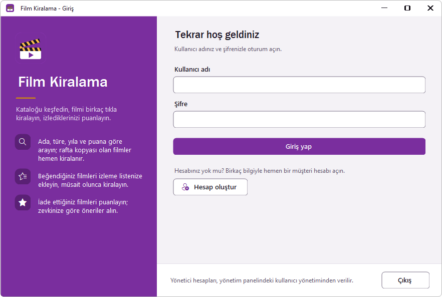](screenshots/giris-2x.png)<br>**Sign-in** ("Giriş") with the brand panel | [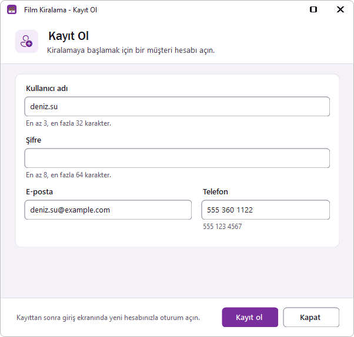](screenshots/kayit-ol-2x.png)<br>**Sign-up** ("Kayıt Ol") |
| [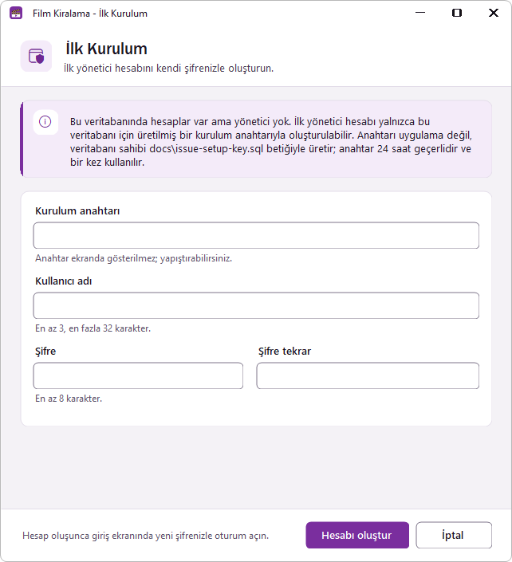](screenshots/ilk-kurulum-2x.png)<br>**First-run setup** ("İlk Kurulum") with a setup key | [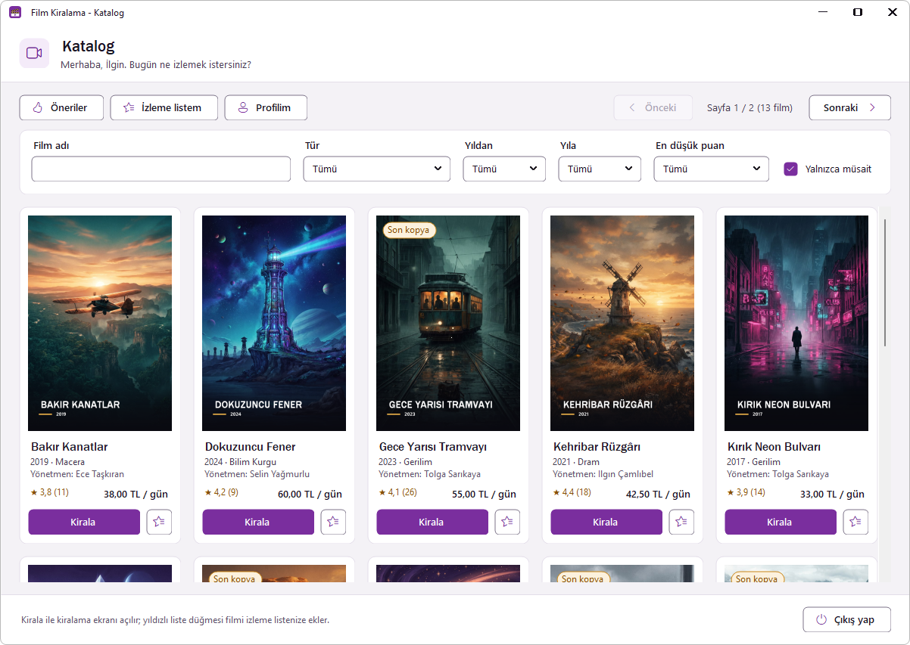](screenshots/katalog-2x.png)<br>**Catalog** ("Katalog"): search row, poster cards, stock pills and pages |
| [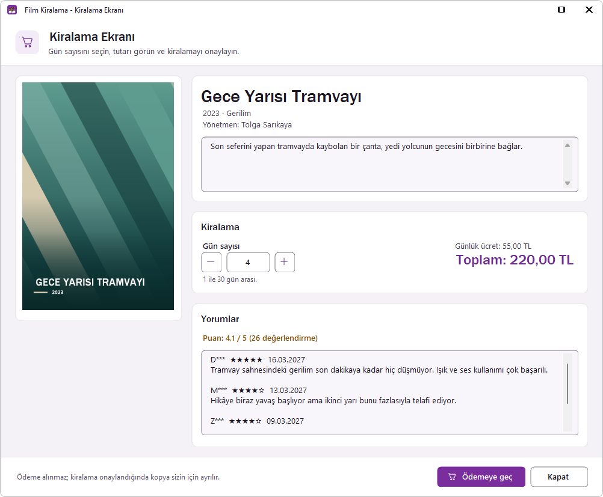](screenshots/kiralama-2x.png)<br>**Rental** ("Kiralama Ekranı") with days, total and reviews | [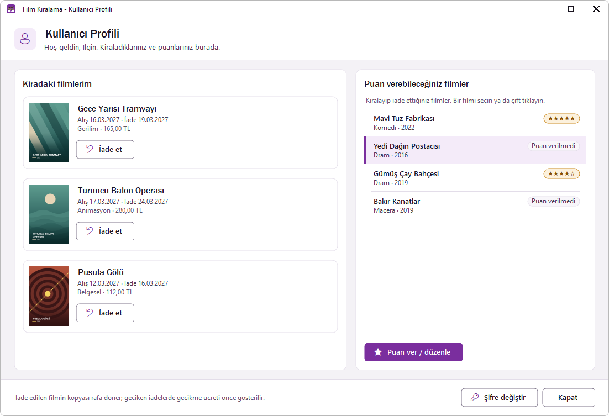](screenshots/profil-2x.png)<br>**Profile** ("Kullanıcı Profili"): films out and films to rate |
| [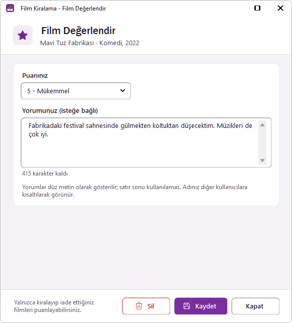](screenshots/degerlendirme-2x.png)<br>**Review** ("Film Değerlendir") of a returned film | [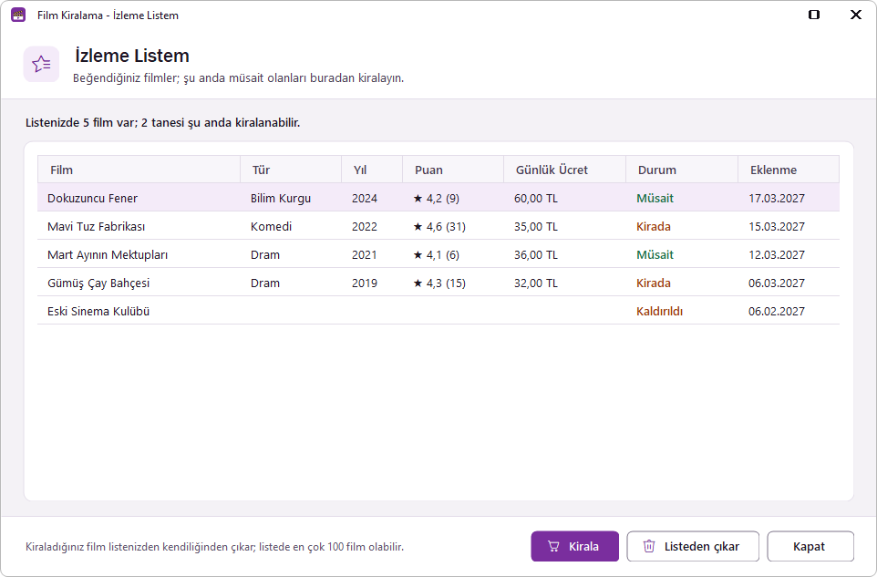](screenshots/izleme-listesi-2x.png)<br>**Watchlist** ("İzleme Listem") with the state of each film |
| [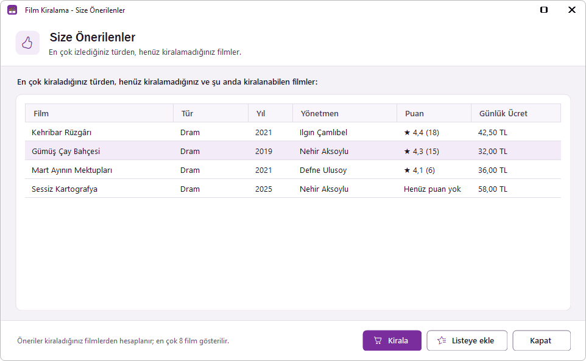](screenshots/oneriler-2x.png)<br>**Recommendations** ("Size Önerilenler") | [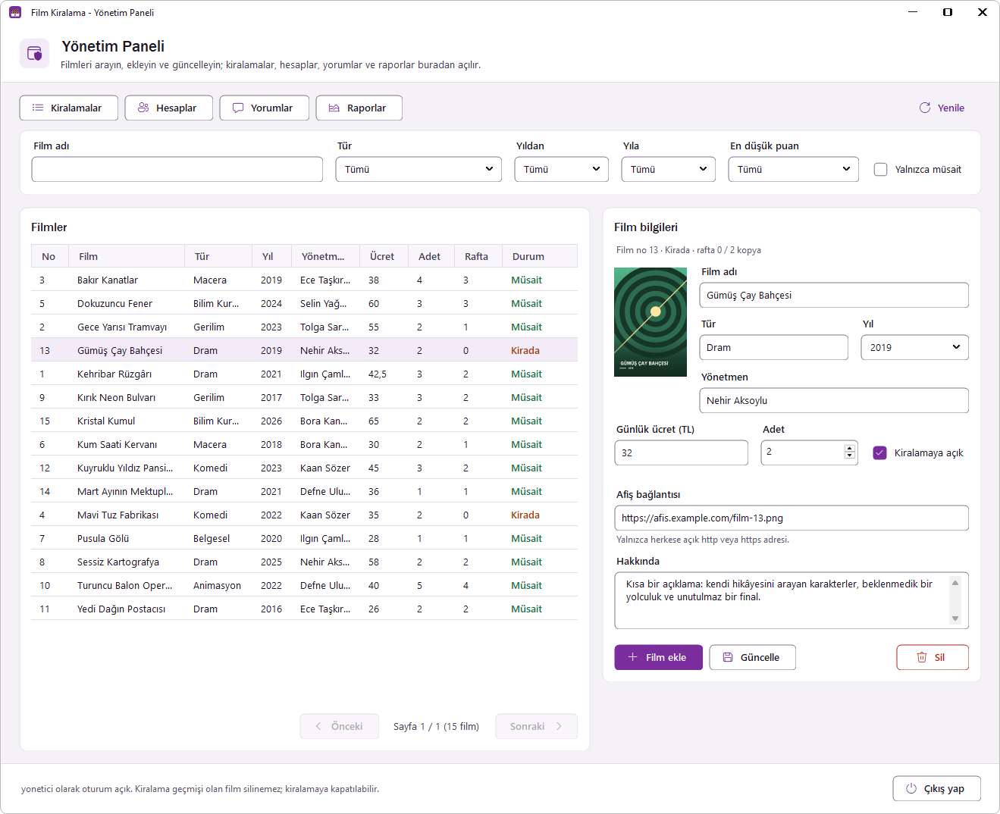](screenshots/yonetim-paneli-2x.png)<br>**Admin panel** ("Yönetim Paneli"): film table and editor |
| [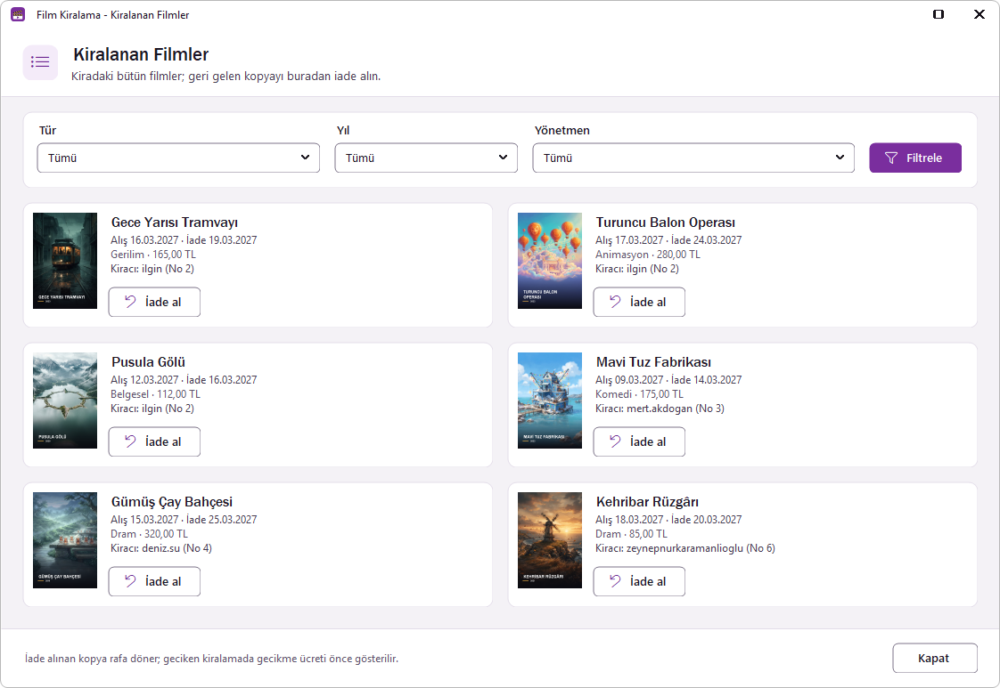](screenshots/kiralanan-filmler-2x.png)<br>**Rented films** ("Kiralanan Filmler") with the take-back of each | [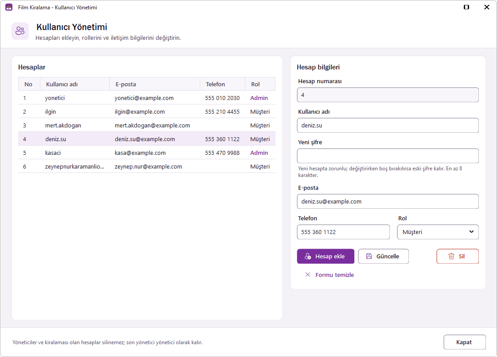](screenshots/hesaplar-2x.png)<br>**Accounts** ("Kullanıcı Yönetimi") |
| [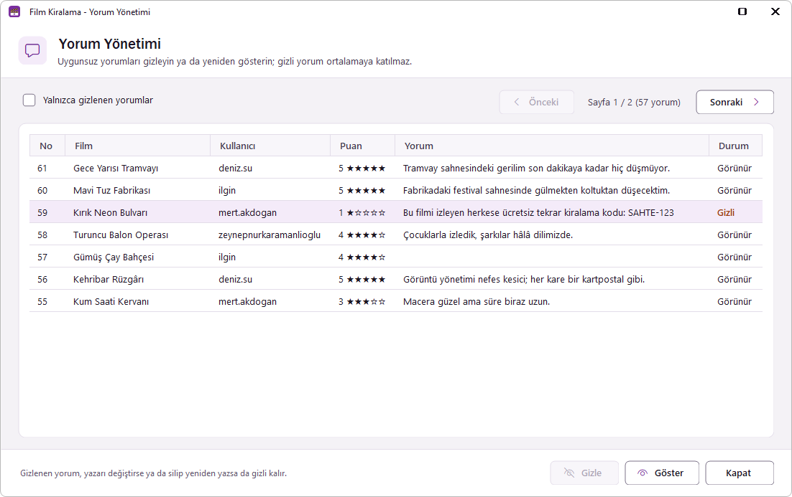](screenshots/yorumlar-2x.png)<br>**Review moderation** ("Yorum Yönetimi") with a hidden review | [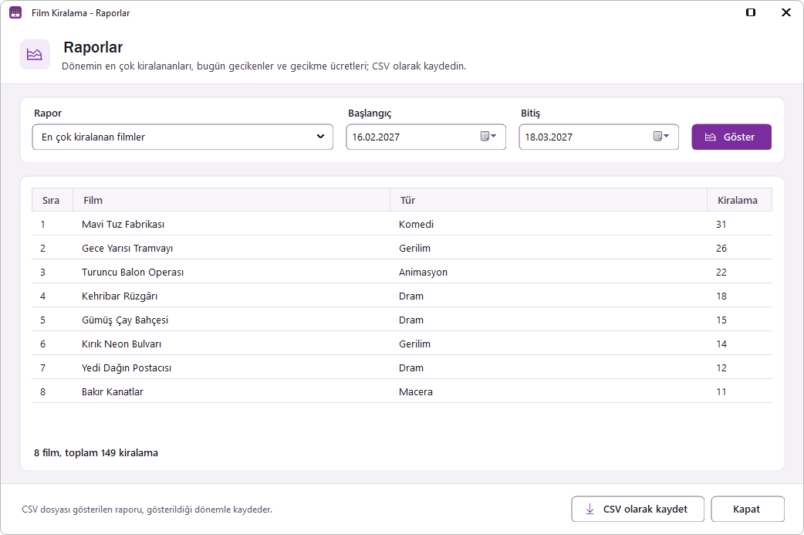](screenshots/raporlar-2x.png)<br>**Reports** ("Raporlar") with CSV export |
| [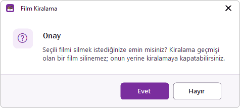](screenshots/onay-penceresi-2x.png)<br>**Confirmation** ("Onay") before a film is deleted | |

### Design

- **Identity:** an original logo (an open clapperboard with marquee gold stripes and a play sign on a velvet plum
  tile, `assets/logo.svg`), a velvet plum accent with a marquee gold mark (rating stars, the last copy on the shelf)
  on plum-tinted neutrals, Franklin Gothic Medium headings (Segoe UI Semibold where it is missing) and Segoe UI body
  text. A film without a poster shows the application's own placeholder (`assets/poster.svg`). No third-party brand,
  poster or title is used.
- **Themes:** light (default), dark and Windows high contrast. `Appearance:Theme` in `appsettings.json` takes
  `Light`, `Dark` or `System` (follows the Windows app mode); high contrast always wins and uses the system colours,
  with selected rows in the system highlight colours. Open windows follow a change of the contrast or app mode while
  the application runs.
- **Layout:** every screen shares one frame (header, inline message strip, scrolling body, footer with the actions),
  is per-monitor DPI aware and opens no larger than the working area of its screen. Results and rule refusals are
  shown inside the window; only questions open a themed message window. Lists and tables say when they load and
  why they are empty; long titles and user names end in an ellipsis and never hide a state or a price.

---

## 🔑 Permission Matrix

| Action | User | Admin |
|---|---|---|
| Sign up an account | ✅ (from the sign-in screen, user role) | ❌ (the first admin comes from the setup) |
| Sign in | ✅ | ✅ |
| Browse and search the catalog | ✅ listed films (available only by default) | ✅ every film, unlisted ones included |
| Rent a film | ✅ one active rental per film | ✅ (through the services; the admin screens do not offer it) |
| List active rentals | ✅ their own | ✅ all, with filters |
| Return a rental | ✅ their own | ✅ any |
| Change their own password | ✅ (profile) | ✅ (through the account management) |
| Keep a watchlist | ✅ their own (another account's entry = missing) | ✅ their own |
| Rate and review a film | ✅ only films they returned; change or delete their own | ✅ same rule as users |
| See reviews and averages | ✅ visible reviews, authors masked | ✅ every review with the full author (moderation list) |
| Hide or show a review | ❌ | ✅ |
| Reports and CSV export | ❌ | ✅ |
| Recommendations | ✅ from their own rentals | ✅ from their own rentals |
| Add, change or delete films | ❌ | ✅ |
| Add, change or delete accounts, set roles | ❌ | ✅ (no admin deleted, the last admin stays admin) |
| Create the first admin | ❌ (empty database, or with the owner's setup key only) | - |

---

## 🧰 Tech Stack

| Area | Used |
|---|---|
| Platform | .NET 10 (`net10.0-windows` UI, `net10.0` libraries) |
| UI | Windows Forms |
| Data access | Entity Framework Core 10 (SQL Server provider) |
| Database | Microsoft SQL Server (Express is enough) |
| Password hashing | PBKDF2-HMAC-SHA256 (`Rfc2898DeriveBytes.Pbkdf2`) |
| Validation | FluentValidation |
| Configuration / DI | Microsoft.Extensions.Configuration (JSON, user secrets, environment), Microsoft.Extensions.DependencyInjection |
| Logging | Serilog (file sink, daily rolling) |
| Testing | xUnit v3, Moq, EF Core SQLite (in-memory), real SQL Server tests |
| CI | GitHub Actions (`.github/workflows/ci.yml`) |

---

## 🗂️ Project Structure

```text
FilmKiralamaApp/
├── src/
│   ├── FilmKiralama.Domain/     # Entities (User, Film, Rental, SetupKey) and repository contracts
│   ├── FilmKiralama.Business/   # Auth, setup, film, rental and account services, late fee, Security/ (PBKDF2, lockout, setup keys), Validation/ (FluentValidation), Auditing/
│   ├── FilmKiralama.Data/       # EF Core DbContext, configurations, Persistence/Migrations/, legacy upgrade, film locks, demo data, repositories
│   └── FilmKiralama.UI/         # WinForms screens, Theming/ (palettes, fonts, themed controls), Infrastructure/ (screen frame, film cards, errors, logging, dialogs, write guard, poster loader), Program.cs (composition root)
├── tests/
│   ├── FilmKiralama.Business.Tests/  # Validators, audit codes, hashing, lockout, rental rules, late fees and ownership (Moq)
│   ├── FilmKiralama.Data.Tests/      # Services on SQLite; races, setup keys and the legacy upgrade on SQL Server
│   └── FilmKiralama.UI.Tests/        # Configuration, errors, logs, posters, focus, write guards, themes, layout and tab order of every screen (no windows shown)
├── assets/                      # Original logo, icon and poster placeholder with their SVG sources
├── tools/Screenshots/           # Icon and screenshot tool (offscreen, invented data, AI-made poster pictures with titles set in code)
├── docs/
│   ├── issue-setup-key.sql      # Setup key, run by the database owner
│   ├── grant-app-login.sql      # Rights of the application's own login
│   └── THREAT_MODEL.md          # Threat model
├── screenshots/                 # Screenshots at 1x and 2x
├── .github/workflows/ci.yml     # Build, test, SQL Server and release workflow
├── CHANGELOG.md
└── FilmKiralama.sln
```

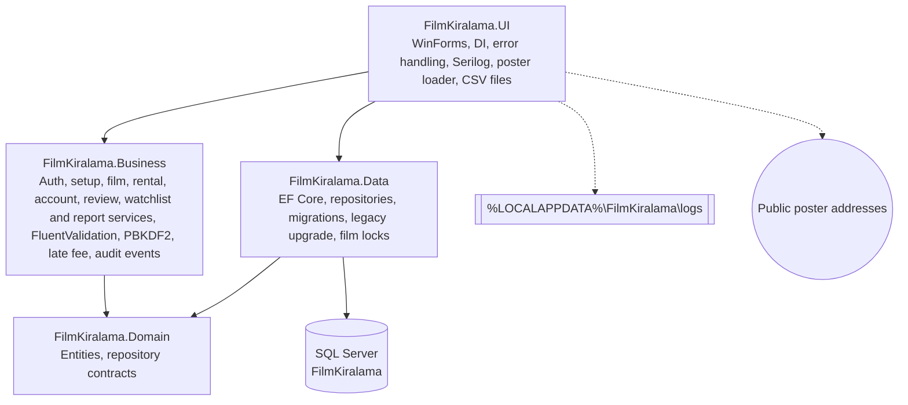

The UI references Data only to register dependencies at startup; forms work through the Business services, which
take the signed-in session on every call. All database access is asynchronous and parameterised. The provider is
configured through DI (`AddDataAccess`), so tests can use SQLite in-memory.

---

## 🛠️ Setup and Usage

### Requirements

- .NET 10 SDK (Windows)
- SQL Server (Express is enough)

```powershell
git clone https://github.com/ayberkaarda/FilmKiralamaApp.git
cd FilmKiralamaApp
dotnet build -c Release
```

### 1. Configuration

The connection string is never written into the code. Provide one named `FilmKiralama`; any of the following works
(later ones override earlier ones):

1. **`appsettings.json`**: copy `src/FilmKiralama.UI/appsettings.example.json` to `appsettings.json` in the same
   folder and edit `ConnectionStrings:FilmKiralama`. `appsettings.json` is git-ignored.

   ```json
   {
     "ConnectionStrings": {
       "FilmKiralama": "Server=localhost\\SQLEXPRESS;Database=FilmKiralama;Trusted_Connection=True;TrustServerCertificate=True;"
     },
     "Seed": {
       "Demo": false
     },
     "Rental": {
       "DailyLateFee": 10.00,
       "MaxRentalDays": 365
     },
     "Appearance": {
       "Theme": "Light"
     }
   }
   ```

2. **User secrets**:

   ```powershell
   dotnet user-secrets set "ConnectionStrings:FilmKiralama" "Server=YOUR_SERVER_NAME;Database=FilmKiralama;Trusted_Connection=True;TrustServerCertificate=True;" --project src/FilmKiralama.UI
   ```

3. **Environment variable** `ConnectionStrings__FilmKiralama`.
4. **Environment variable** `FILM_CONNECTION` (highest priority):

   ```powershell
   $env:FILM_CONNECTION = "Server=YOUR_SERVER_NAME;Database=FilmKiralama;Trusted_Connection=True;TrustServerCertificate=True;"
   ```

> Replace `YOUR_SERVER_NAME` with your SQL Server instance, for example `localhost\SQLEXPRESS`. Inside JSON the `\`
> is written as `\\`. `TrustServerCertificate=True` is meant for a local development server only.

The `Rental` section sets the late fee per day (0-10,000, at most two decimals, written with a decimal point in
JSON) and the longest rental in days (1-3650). If no connection string is found or the rental settings are invalid,
the application shows a Turkish message naming the problem and exits. `Appearance:Theme` chooses the palette:
`Light` (default), `Dark` or `System`; any other value falls back to `Light`, and Windows high contrast always wins.

### 2. Running

```powershell
dotnet run --project src/FilmKiralama.UI
```

You do not need to create tables by hand: the database is created on first start and pending EF Core migrations
are applied automatically on every start.

### 3. Database migrations and upgrading an old database

New migrations are applied by the application on start. To list them, apply them by hand or add one:

```powershell
dotnet tool restore
dotnet ef migrations list --project src/FilmKiralama.Data
dotnet ef database update --project src/FilmKiralama.Data
dotnet ef migrations add <Name> --project src/FilmKiralama.Data --output-dir Persistence/Migrations
```

The design-time factory reads `FILM_CONNECTION` and otherwise uses a local SQL Server Express instance. Apply
migrations with the database owner's connection; the application's restricted login has no DDL rights.

**Upgrading the original application's database:** `dotnet ef database update` does **not** upgrade it. Such a
database has the tables `Kullanicilar`, `Filmler` and `Kiralama` but no migrations history, so EF Core would try to
create the tables again. Start the application instead: on start-up `DatabaseInitializer` first runs the legacy
upgrade, which brings the old tables to the shape of the first migration and records it as applied, and only then
applies the remaining migrations. The upgrade keeps every row, identity value and plain text password: passwords
are marked as legacy plain text and hashed on each account's next successful sign-in, every film gets one copy, the
original rentals become active rentals with their planned return day, and a film that was hidden by hand stays
unlisted. It runs in one transaction under an application lock (`sp_getapplock`), so concurrent starts upgrade
once, and it is safe to repeat. When rows have no certain meaning (an unknown role or status, a film marked
available while it is rented, a film rented twice, a rental without its film), it stops before changing anything
and the application lists the problems as counts only.

Take a backup of the database before the first start with the new version and keep it protected: it still
contains the plain text passwords.

### 4. First-run setup

- **Empty database (no account at all):** the default installation creates no account and contains no ready-made
  password. The **"İlk Kurulum"** (First-Run Setup) screen opens and you create the first admin account with a
  password of your own choosing. No key is needed. Closing the setup ends the application.
- **Database with accounts but no admin** (for example an upgraded old database): the application opens with the
  normal sign-in; a missing admin alone gives nobody any rights. The first admin can be created only with a
  **setup key**: the **"İlk yönetici hesabını oluştur"** (Create the first admin account) link on the sign-in screen
  opens the setup form, which asks for the key ("Kurulum Anahtarı", Setup Key).
- The application never creates keys. Only the **database owner** (db_owner or sysadmin) runs
  `docs/issue-setup-key.sql` connected to the application's database, for example
  `sqlcmd -S <server> -d <database> -E -i docs\issue-setup-key.sql`. The script makes a 32 hexadecimal character
  key from 16 random bytes (128 bits), stores only its SHA-256 hash in the `KurulumAnahtarlari` table and shows the
  key once. It refuses to issue a key when the database already has an admin.
- `docs/grant-app-login.sql` gives the application's own login example rights: on the key table only reading and
  marking a key used; it cannot add, delete or change a key. Rentals are never deleted. Do the first start (schema
  creation or upgrade) with the database owner's connection, then point the application's connection string at
  this login.
- Type the key into the form (dashes, spaces and letter case do not matter) or provide it with the
  `FILM_SETUP_KEY` environment variable, which only fills in the field. A key is valid for 24 hours and works once:
  it is marked used together with the write that creates the admin account. Its expiry is decided by the
  database's clock, and every wrong attempt is followed by a 1 second pause.

### 5. Demo mode

Demo mode is opt-in and off by default. The environment variable `FILM_DEMO=1` (or `true`), or
`"Seed": { "Demo": true }` in `appsettings.json`, adds fictional films and accounts only to a completely empty
database. Only with demo mode on are these accounts created:

| Role | User name (demo mode only) | Password (demo mode only) |
|---|---|---|
| Admin | `yonetici` | `Demo.Yonetici1` |
| User | `ornek` | `Demo.Kullanici1` |

Never switch demo mode on for a real installation.

### 6. Logs

Logs are written to `%LOCALAPPDATA%\FilmKiralama\logs`, one file per day (`filmkiralama-yyyyMMdd.log`). Files older
than 30 days are deleted, and at most 30 files are kept. The folder is outside the repository. Error entries contain
only exception types, HResult codes and the method names of the stack trace (no messages, no file paths). Refused
operations leave no entry of their own. Audit entries are a fixed code and a role only, never an account or a film:
every failed sign-in (empty field, unknown account, wrong password or locked account) writes the same code,
`auth.sign_in.failed unknown`; a new account and a sign-up with taken values both write
`auth.account.registration_submitted user`; returning another account's rental leaves the same entries as
returning one that does not exist.

User names, e-mail addresses, phone numbers, passwords, setup keys, film titles and exception messages are never
written to the log.

---

## 🔐 Security

See [docs/THREAT_MODEL.md](docs/THREAT_MODEL.md) for the threat model.

- Passwords are hashed with PBKDF2; the stored format is kept in its own column, so a value is never read in
  another format.
- A failed sign-in is counted by one conditional update that matches only while the account is unlocked (by the
  database's clock) and still has the password and session version that were checked, and a successful sign-in
  is written only while the account is still unlocked and unchanged, so concurrent attempts can neither clear a
  fresh lock nor count against a new password. Every sign-in that reaches the database makes the same calls in
  the same order, whatever the outcome; the response time is not constant.
- Roles and ownership are checked in the services and repeated in the database statements; the acting account,
  its session version and its stored role are checked inside every operation. A new password (set by an admin or
  by the account itself) or a new role raises the session version and ends the sessions issued before.
- The account and film forms send back the version they loaded; a change from a stale form writes nothing.
- Poster addresses come from the database, so they are downloaded only from public addresses (also when a private
  IPv4 address hides in a NAT64, 6to4, IPv4-compatible, IPv4-mapped or IPv4-translated IPv6 address), with redirects
  checked again and never from https to http, at most 2 MB and within 10 seconds; local paths, network shares and local network addresses are
  never opened. The pixel size is read from the file header and an image beyond 4096 pixels a side or 16
  megapixels is refused before it is decoded; at most three posters download and decode at a time, and a decoded
  poster is kept only at card size (at most 480 × 720), so a page of cards holds about 1.4 MB a poster.
- Review comments are plain text with a length limit; neither comments nor searches nor names reach the log file,
  and refused or foreign review and watchlist operations leave the same entries (none) as missing ones.
- Report CSV files are spreadsheet safe (formula prefixes) and replace a file only once they are complete.
- Connection strings are kept out of the repository (`appsettings.json` is ignored; user secrets and environment
  variables are supported). All queries go through EF Core with parameters.
- Users only see Turkish messages; raw exception text is never shown.

---

## 🧪 Testing

```powershell
dotnet test -c Release
```

| Project | Type | Scope |
|---|---|---|
| `tests/FilmKiralama.Business.Tests` | Unit | Validator limits and message order (user name 3/32, password 8/64, e-mail, phone, film fields, rental days, ratings 0/1/5/6, comments 500/501, search and page limits, report periods), audit codes, PBKDF2 and format upgrade, lockout and rental days by the shared clock, rental and return rules, late fees, average rounding, CSV formula safety, recommendations, ownership and admin checks with strict Moq mocks |
| `tests/FilmKiralama.Data.Tests` | Integration | Services and repositories on SQLite in-memory (shelf at zero, one and every copy, the last copy, the first late day, IDOR answers, lockout length, stale sessions, refused input writes nothing, LIKE escaping, stable pages, rating filters, rating before the return, foreign reviews and watchlist entries, the watchlist limit, report periods); rental, lockout, review, watchlist and clock races, setup keys with the restricted login and the legacy upgrade on SQL Server |
| `tests/FilmKiralama.UI.Tests` | Unit | Example configuration, error messages, log content and retention, poster header limits and download slots, IPv6 transition addresses, focus after unlock, write guards, latest-wins searches and pages, lists bound without a selection, plain text reviews, CSV files, neutral branding; every screen built without being shown: palette contrast, high contrast colours (also switched on while windows are open), themed controls, layout inside the window at four text sizes on 1024x600, 1366x768 and 1920x1040 working areas, tab order and inline messages |

The SQL Server tests use throw-away databases on the server in `FILM_TEST_SQLSERVER` (default: local SQL Express
with Windows authentication). They are skipped when `FILM_SKIP_SQL_TESTS=1` is set or no server is reachable; with
`FILM_REQUIRE_SQL_TESTS=1` (the SQL Server job of the CI) an unreachable server fails them instead. The temporary
databases are dropped afterwards. The test with a restored backup of the original database runs only when
`FILM_LEGACY_BACKUP` points to a `.bak` file readable by the SQL Server service.

```powershell
$env:FILM_SKIP_SQL_TESTS = "1"; dotnet test -c Release
```

On SQLite the schema is created from the model instead of migrations. The UI tests create forms without showing
them and replace every message box, so no window opens.

---

## 🚀 CI and Release

`.github/workflows/ci.yml` runs on pushes to `main`, on pull requests and on `v*` tags:

1. **build-test** (Windows): `dotnet build -c Release` and `dotnet test -c Release` (SQL Server tests skipped)
2. **sql-server** (Linux): the data tests against a throw-away SQL Server container, with
   `FILM_REQUIRE_SQL_TESTS=1`
3. **release** (only on `v*` tags): the tag name is passed through an environment variable and checked against
   `^v[A-Za-z0-9._-]+$`; a framework-dependent win-x64 build is then published and uploaded as the workflow
   artifact `FilmKiralama-<tag>-win-x64.zip`, together with the READMEs, the changelogs and `docs/*.sql`

To produce the same build locally:

```powershell
dotnet publish src/FilmKiralama.UI -c Release -r win-x64 --self-contained false -o ./publish
```

The target machine needs the .NET 10 Desktop Runtime. Put `appsettings.json` next to `FilmKiralama.exe` or set
`FILM_CONNECTION`.

---

## 👨‍💻 Developer Notes

- See [CHANGELOG.md](CHANGELOG.md) for the version history.
- `Program.cs` is the composition root: configuration, DI, logging, the audit sink and the global
  `ThreadException` / `UnhandledException` handlers are set up there.
- Business rule violations raise `BusinessRuleException` and permission violations `AccessDeniedException`, both
  with fixed Turkish messages that the UI shows as warnings.
- Validators live in `FilmKiralama.Business/Validation`. The account validators stop at the first failure, so the
  user sees one message at a time; the film validator reports every invalid field.
- New write buttons should go through `ExclusiveOperation` and move the focus with `FocusAfterUnlock`; loads
  triggered by a selection should use `RequestSequence` so only the latest response is shown, and binding data in
  code must not count as a user's selection. Message boxes go through `Dialogs` or `IUserPrompts`, never
  `MessageBox` directly.
- New screens derive from `AppDialog`, build their layout with `FormLayout` and read colours only from
  `Theme.Current` (`Theming/`); the layout tests in `tests/FilmKiralama.UI.Tests` build every screen listed in
  `TestForms` at four text sizes on three working areas.
- Audit events carry only an event kind and a role; do not add identifying data to them.

---

## 📧 Contact

Feel free to get in touch with questions about the project, or send a pull request.

## License

Released under the [MIT License](LICENSE).
