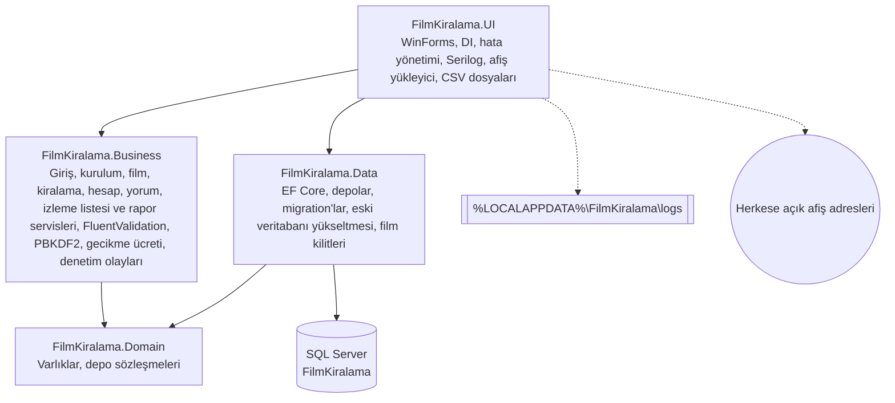

# 🎬 Film Kiralama - Film Kiralama Sistemi (C# & SQL Server)

🇬🇧 [English](README.md) · 🇹🇷 **Türkçe**

.NET 10 ve SQL Server ile geliştirilmiş, bir film kiralama dükkânı için Windows Forms uygulaması: müşteriler
hesap oluşturur, katalogda gezinir, bir filmin bir kopyasını belirli gün sayısı için kiralar ve iade eder;
yöneticiler filmleri, stoğu, hesapları ve tüm aktif kiralamaları yönetir, geç iadelere günlük gecikme ücreti
uygulanır. Kod Domain, Business, Data ve UI katmanlarına ayrılmıştır; veritabanı erişimi EF Core ile yapılır ve
veritabanı açılışta otomatik olarak oluşturulur, migration'ları uygulanır ya da yükseltilir.

> Uygulamanın arayüzü Türkçedir. İngilizce README'de ekran ve düğme adları önce Türkçe etiketiyle, ardından
> İngilizce karşılığıyla verilir, örneğin "Film Ekle" (Add Film).

---

## 📦 Özellikler

### Film kataloğu

- ✅ **Katalog** ("Film Kirala"): kiralamaya açık filmler; afiş, ad, tür, yıl, yönetmen, günlük ücret ve ortalama
  puanla. "Yalnızca müsait" (varsayılan olarak açık) rafta kopyası olan filmleri bırakır. Kopyası kalmayan filmde
  kiralama düğmesi yerine "Stokta yok" görünür.
- ✅ **Arama**: ad ("Film adı", adın herhangi bir yerinde aranır; `%`, `_` ve `[` yalnızca kendileriyle eşleşir), tür,
  yıl aralığı ("Yıldan", "Yıla") ve en düşük puan ("En düşük puan", gösterilen ortalamayla karşılaştırılır). Liste
  servis tarafında sayfalanır (sayfada 12 film, "Önceki" / "Sonraki") ve önce ada, sonra numaraya göre sıralanır,
  böylece sayfalar hiç örtüşmez; son sayfadan sonrası istenirse son sayfa gösterilir. Arama listelerinin
  doldurulması kendiliğinden yükleme başlatmaz; hem müşteri hem yönetici ekranında yalnızca son aramanın ya da son
  sayfanın cevabı gösterilir.
- ✅ **Afişler** arka planda ve yalnızca herkese açık http veya https adreslerinden yüklenir; diğer her durumda
  uygulamanın kendi yer tutucu görseli gösterilir.

### Kiralama ve iade

- ✅ **Kiralama** ("Kirala" → "Kiralama Ekranı"): gün sayısı ("Gün Sayısı") 1 ile ayarlardaki üst sınır (varsayılan
  365) arasında seçilir; toplam tutar günlük ücret ("Günlük Ücret") çarpı gün sayısıdır. "Ödemeye Geç" başlangıç ve
  bitiş tarihlerini gösterip onay ister. Ödeme alınmaz.
- ✅ **Film başına bir aktif kiralama**: bir hesap aynı filmi iade etmeden yeniden kiralayamaz.
- ✅ **Ücret kontrolü**: teklif gösterildikten sonra günlük ücret değişirse kiralama reddedilir ve hiçbir şey
  yazılmaz.
- ✅ **İade** ("İade Et"): müşterinin profil ekranında ("Kullanıcı Profili") hesabın kendi aktif kiralamaları
  listelenir; yöneticiler kiralama panelinde ("Kiralama Paneli") herhangi bir kiralamayı iade alır ("İade Al").

### İzleme listesi

- ✅ Katalogdaki her kartta ve önerilerde bulunan **"Listeye Ekle"** filmi müşterinin kendi izleme listesine
  ("İzleme Listem") ekler; her film bir kez (aynı anda iki ekleme için de tekil indeks karar verir), en fazla 100
  film.
- ✅ Liste hangi filmlerin şu anda kiralanabildiğini gösterir; "Kirala" filmi doğrudan listeden kiralar ve kiralama
  filmi aynı işlemde listeden çıkarır. "Listeden Çıkar" bir filmi listeden kaldırır.
- ✅ Her hesap yalnızca kendi listesine ulaşır: başka bir hesabın kaydı, olmayan bir kayıtla aynı cevabı alır.

### Puanlama ve yorumlar

- ✅ Müşteri yalnızca **kiralayıp iade ettiği** bir filme 1-5 yıldız ve isteğe bağlı, en fazla 500 karakterlik bir
  yorum verir (profilde "Puan Ver / Düzenle"). Hesap ve film başına bir değerlendirme vardır; değiştirilebilir ya da
  silinebilir. Hâlâ kirada olan ya da hiç kiralanmamış filme puan verilemez.
- ✅ Kiralama ekranı filmin ortalama puanını (tek ondalık, yarımlar sıfırdan uzağa yuvarlanır, servis tarafından
  `decimal` ile hesaplanır) ve en yeni görünür yorumlarını gösterir. Yazarlar maskeli ("O***"), yorumlar düz metin
  olarak gösterilir: biçimlendirme etiketleri, `&` ve formül karakterleri yazıldığı gibi görünür; satır sonu, kontrol
  ve görünmeyen biçim karakterleri (sağdan sola yazım geçersiz kılma gibi) reddedilir.
- ✅ Yöneticiler bir yorumu gizler ya da yeniden gösterir ("Yorumlar"); gizlenen yorum herkese açık listeden ve
  ortalamadan çıkar, yazarı değiştirse ya da silip yeniden yazsa da gizli kalır (silinen gizli yorum yorumu
  olmadan gizli işaretini korur ve yönetici dahil kimseye gösterilmez).

### Raporlar ve öneriler

- ✅ **Raporlar** ("Raporlar", yöneticiler): bir dönemin en çok kiralanan filmleri (ilk 20), bugün geciken
  kiralamalar ve şimdiye kadarki gecikme ücretleri, bir dönemde iade edilen kiralamaların gecikme ücretleri ve
  toplamları (`decimal` ile toplanır). Dönemin iki ucu da dahildir; bir dönem en fazla 3660 gün olabilir.
- ✅ Gösterilen raporun, gösterildiği dönemle **CSV olarak kaydedilmesi**: bayt sıra işaretli UTF-8, tırnaklı alanlar
  arasında `;`, hesap tablosunun formül olarak çalıştıracağı her alanın başında `'`; dosya önce hedef klasörde geçici
  bir dosyaya yazılır, sonra hedefin üzerine taşınır.
- ✅ **Öneriler** ("Öneriler", müşteriler): müşterinin en çok kiraladığı türün (en çok kiralanan türler eşitse hepsi)
  daha önce kiralamadığı ve şu anda kiralanabilen filmleri; en yüksek puanlılar önce, en fazla 8 film.

### Stok

- ✅ Her filmin kopya sayısı ("Adet", 1-1000) ve raftaki kopya sayısı vardır. Kiralama raftan bir kopya alır, iade
  geri koyar; ikisi de filmin kilidi altında tek bir veritabanı işleminde yapılır, böylece eşzamanlı müşteriler
  dükkânın sahip olduğundan fazla kopya alamaz; son kopya yalnızca birine gider.
- ✅ Rafta kopyası kalmayan film, bir kopya geri gelene kadar kiralanamaz; "Yalnızca müsait" açıkken katalogda
  görünmez.
- ✅ Bir filmin kopya sayısı kirada olan kopya sayısının altına indirilemez; "Kiralamaya açık" seçeneği filmi
  silmeden müşterilerden gizler.

### Gecikme ücreti

- ✅ Bitiş gününden sonraki iade, bitiş gününden sonraki her takvim günü için ayarlardaki ücreti
  (`Rental:DailyLateFee`, varsayılan 10,00) öder; bitiş gününde yapılan iade ücretsizdir. Ücret `decimal` ile
  hesaplanır, kiralamayla birlikte saklanır ve para sütununun alabileceği en büyük tutarla sınırlanır.
- ✅ İadenin bugün ne kadar gecikme ücreti tutacağı, iade onaylanmadan önce gösterilir.
- ✅ Kiralama, bitiş ve iade günleri, nelerin geciktiği ve 15 dakikalık giriş kilidi veritabanı sunucusunun UTC
  saatine (`SYSUTCDATETIME()`) göre belirlenir; saati yanlış olan bilgisayarlar da aynı sonuca varır. Kiralama ve
  iade onay pencereleri tarihleri ve gecikme ücretini aynı saatten hesaplar; onaylanan, saklananla aynıdır.

### Yönetim paneli

- ✅ **Filmler** ("Yönetim Paneli"): kiralamaya kapalılar dahil tüm filmlerde aynı arama alanlarıyla, sayfada 50
  filmle arama; ad, tür, yıl, yönetmen, günlük ücret, resim linki ("Resim Linki"), açıklama ("Hakkında") ve adetle
  film ekleme ("Film Ekle"), güncelleme ("Filmi Güncelle") ve silme ("Filmi Sil"). Her geçersiz alan kendi kontrolünün
  yanında işaretlenir. Kiralama geçmişi olan film silinemez; bunun yerine kiralamaya kapatılabilir.
- ✅ **Hesaplar** ("Kullanıcı Yönetim Paneli"): rol, e-posta ve telefonla hesap ekleme, güncelleme ve silme; yeni
  şifre eskisinin yerine geçer ve kilidi kaldırır. Yöneticiler ve kiralaması olan hesaplar silinemez, son yönetici
  yönetici rolünde kalır.
- ✅ **Kiralamalar** ("Kiralanan Filmler"): tür, yönetmen ve yıla göre filtrelenebilen tüm aktif kiralamalar; iade
  alınmadan önce bugünkü gecikme ücreti gösterilir.

### Güvenlik

- ✅ Şifreler PBKDF2-HMAC-SHA256 özeti olarak saklanır (600.000 tekrar, rastgele tuz); eski uygulamanın düz metin
  şifreleri bir sonraki başarılı girişte özetle değiştirilir.
- ✅ 5 hatalı giriş hesabı 15 dakika kilitler; bilinmeyen hesap, yanlış şifre ve kilitli hesap aynı cevabı alır.
- ✅ Her çağrı açık oturuma göre denetlenir ve her yetkili işlem hesabın veritabanındaki rolünü yeniden kontrol eder:
  silinen ya da yetkisi düşürülen hesabın açık oturumundan yeniden giriş yapması istenir. Müşteriler yalnızca kendi
  kiralamalarına ulaşır; başka bir hesabın kiralaması, olmayan bir kiralamayla aynı cevabı alır.
- ✅ Türkçe mesajlı merkezi FluentValidation doğrulayıcıları (boş alan, e-posta biçimi, parola politikası, film
  alanları, kiralama günü); yazma düğmeleri işlem sürerken tekrarlanan tıklamaları yok sayar.
- ✅ Kişisel veri içermeyen, anonim denetim kodlu günlük log dosyaları.

---

## 🖼️ Ekran Görüntüleri

`screenshots/` klasöründeki ekran görüntüleri yeni tasarım için yeniden hazırlanıyor ve tasarımla birlikte geri
gelecek. Önceki görüntüler üçüncü taraf film afişleri içerdiği için kaldırıldı.

---

## 🔑 Yetki Matrisi

| İşlem | Kullanıcı | Yönetici |
|---|---|---|
| Hesap oluşturma | ✅ (giriş ekranından, kullanıcı rolüyle) | ❌ (ilk yönetici kurulumdan gelir) |
| Giriş yapma | ✅ | ✅ |
| Kataloğu görme ve arama | ✅ kiralamaya açık filmler (varsayılan olarak yalnızca müsaitler) | ✅ kiralamaya kapalılar dahil tüm filmler |
| Film kiralama | ✅ film başına bir aktif kiralama | ✅ (servis üzerinden; yönetim ekranları sunmaz) |
| Aktif kiralamaları listeleme | ✅ yalnızca kendi kiralamaları | ✅ tümü, filtrelerle |
| Kiralamayı iade etme | ✅ yalnızca kendi kiralaması | ✅ herhangi biri |
| Kendi şifresini değiştirme | ✅ (profil) | ✅ (hesap yönetiminden) |
| İzleme listesi tutma | ✅ yalnızca kendi listesi (başkasının kaydı = yok) | ✅ yalnızca kendi listesi |
| Filme puan ve yorum verme | ✅ yalnızca iade ettiği filmlere; kendi değerlendirmesini değiştirir ya da siler | ✅ kullanıcılarla aynı kural |
| Yorumları ve ortalamaları görme | ✅ görünür yorumlar, yazarlar maskeli | ✅ tüm yorumlar, yazarın tam adıyla (yönetim listesi) |
| Yorumu gizleme ya da gösterme | ❌ | ✅ |
| Raporlar ve CSV dışa aktarma | ❌ | ✅ |
| Öneriler | ✅ kendi kiralamalarından | ✅ kendi kiralamalarından |
| Film ekleme, güncelleme, silme | ❌ | ✅ |
| Hesap ekleme, güncelleme, silme, rol verme | ❌ | ✅ (yönetici silinmez, son yönetici yönetici kalır) |
| İlk yöneticiyi oluşturma | ❌ (boş veritabanında ya da yalnızca sahibin kurulum anahtarıyla) | - |

---

## 🧰 Teknolojiler

| Alan | Kullanılan |
|---|---|
| Platform | .NET 10 (`net10.0-windows` arayüz, `net10.0` kütüphaneler) |
| Arayüz | Windows Forms |
| Veri erişimi | Entity Framework Core 10 (SQL Server sağlayıcısı) |
| Veritabanı | Microsoft SQL Server (Express yeterli) |
| Şifre özeti | PBKDF2-HMAC-SHA256 (`Rfc2898DeriveBytes.Pbkdf2`) |
| Doğrulama | FluentValidation |
| Yapılandırma / DI | Microsoft.Extensions.Configuration (JSON, user secrets, ortam değişkenleri), Microsoft.Extensions.DependencyInjection |
| Loglama | Serilog (dosya, günlük dönen) |
| Test | xUnit v3, Moq, EF Core SQLite (bellek içi), gerçek SQL Server testleri |
| CI | GitHub Actions (`.github/workflows/ci.yml`) |

---

## 🗂️ Proje Yapısı

```text
FilmKiralamaApp/
├── src/
│   ├── FilmKiralama.Domain/     # Varlıklar (User, Film, Rental, SetupKey) ve depo sözleşmeleri
│   ├── FilmKiralama.Business/   # Giriş, kurulum, film, kiralama ve hesap servisleri, gecikme ücreti, Security/ (PBKDF2, kilitleme, kurulum anahtarı), Validation/ (FluentValidation), Auditing/
│   ├── FilmKiralama.Data/       # EF Core DbContext, yapılandırmalar, Persistence/Migrations/, eski veritabanı yükseltmesi, film kilitleri, deneme verisi, depolar
│   └── FilmKiralama.UI/         # WinForms ekranları, Infrastructure/ (hatalar, loglama, iletiler, yazma koruması, afiş yükleyici), Program.cs (bileşim kökü)
├── tests/
│   ├── FilmKiralama.Business.Tests/  # Doğrulayıcılar, denetim kodları, şifre özeti, kilitleme, kiralama kuralları, gecikme ücreti ve sahiplik (Moq)
│   ├── FilmKiralama.Data.Tests/      # SQLite üzerinde servisler; SQL Server üzerinde yarışlar, kurulum anahtarı ve eski veritabanı yükseltmesi
│   └── FilmKiralama.UI.Tests/        # Yapılandırma, hatalar, loglar, afişler, odak ve yazma korumaları (pencere gösterilmez)
├── assets/                      # Özgün logo, arka plan, giriş görseli, afiş yer tutucusu ve simge, SVG kaynaklarıyla
├── docs/
│   ├── issue-setup-key.sql      # Kurulum anahtarı, veritabanı sahibi çalıştırır
│   ├── grant-app-login.sql      # Uygulamanın kendi oturumunun yetkileri
│   └── THREAT_MODEL.md          # Tehdit modeli
├── screenshots/                 # Ekran görüntüleri (tasarım güncellemesiyle yeniden hazırlanacak)
├── .github/workflows/ci.yml     # Derleme, test, SQL Server ve sürüm iş akışı
├── CHANGELOG.md
└── FilmKiralama.sln
```



Arayüz, Data katmanına yalnızca açılışta bağımlılıkları kaydetmek için başvurur; formlar her çağrıda açık oturumu
alan Business servisleri üzerinden çalışır. Tüm veritabanı erişimi asenkron ve parametrelidir. Sağlayıcı DI
üzerinden (`AddDataAccess`) yapılandırılır, böylece testler bellek içi SQLite kullanabilir.

---

## 🛠️ Kurulum ve Kullanım

### Gereksinimler

- .NET 10 SDK (Windows)
- SQL Server (Express yeterli)

```powershell
git clone https://github.com/ayberkaarda/FilmKiralamaApp.git
cd FilmKiralamaApp
dotnet build -c Release
```

### 1. Yapılandırma

Bağlantı dizesi koda yazılmaz. `FilmKiralama` adlı bir bağlantı dizesi verin; aşağıdakilerin her biri olur (sonraki
öncekini geçersiz kılar):

1. **`appsettings.json`**: `src/FilmKiralama.UI/appsettings.example.json` dosyasını aynı klasöre `appsettings.json`
   olarak kopyalayıp `ConnectionStrings:FilmKiralama` değerini düzenleyin. `appsettings.json` git'e girmez.

   ```json
   {
     "ConnectionStrings": {
       "FilmKiralama": "Server=localhost\\SQLEXPRESS;Database=FilmKiralama;Trusted_Connection=True;TrustServerCertificate=True;"
     },
     "Seed": {
       "Demo": false
     },
     "Rental": {
       "DailyLateFee": 10.00,
       "MaxRentalDays": 365
     }
   }
   ```

2. **Kullanıcı gizli ayarları (user secrets)**:

   ```powershell
   dotnet user-secrets set "ConnectionStrings:FilmKiralama" "Server=YOUR_SERVER_NAME;Database=FilmKiralama;Trusted_Connection=True;TrustServerCertificate=True;" --project src/FilmKiralama.UI
   ```

3. **Ortam değişkeni** `ConnectionStrings__FilmKiralama`.
4. **Ortam değişkeni** `FILM_CONNECTION` (en yüksek öncelik):

   ```powershell
   $env:FILM_CONNECTION = "Server=YOUR_SERVER_NAME;Database=FilmKiralama;Trusted_Connection=True;TrustServerCertificate=True;"
   ```

> `YOUR_SERVER_NAME` kısmını kendi SQL Server örneğinizin adıyla değiştirin (örneğin `localhost\SQLEXPRESS`). JSON
> içinde `\` karakteri `\\` olarak yazılır. `TrustServerCertificate=True` yalnızca yerel geliştirme sunucusu içindir.

`Rental` bölümü günlük gecikme ücretini (0-10.000, en fazla iki ondalık; JSON'da ondalık nokta ile yazılır) ve en
uzun kiralama süresini gün olarak (1-3650) belirler. Bağlantı dizesi bulunamazsa ya da kiralama ayarları geçersizse
uygulama sorunu belirten Türkçe bir mesaj gösterip kapanır.

### 2. Çalıştırma

```powershell
dotnet run --project src/FilmKiralama.UI
```

Tabloları elle oluşturmanız gerekmez: veritabanı ilk açılışta oluşturulur ve bekleyen EF Core migration'ları her
açılışta otomatik uygulanır.

### 3. Migration'lar ve eski veritabanını yükseltme

Yeni migration'ları uygulama açılışta uygular. Listelemek, elle uygulamak ya da yeni bir migration eklemek için:

```powershell
dotnet tool restore
dotnet ef migrations list --project src/FilmKiralama.Data
dotnet ef database update --project src/FilmKiralama.Data
dotnet ef migrations add <Ad> --project src/FilmKiralama.Data --output-dir Persistence/Migrations
```

Tasarım zamanı fabrikası `FILM_CONNECTION` değerini okur, yoksa yerel SQL Server Express örneğini kullanır.
Migration'ları veritabanı sahibinin bağlantısıyla uygulayın; uygulamanın kısıtlı oturumunun DDL yetkisi yoktur.

**Eski uygulamanın veritabanını yükseltme:** `dotnet ef database update` bu veritabanını **yükseltmez**. Böyle bir
veritabanında `Kullanicilar`, `Filmler` ve `Kiralama` tabloları vardır ama migration geçmişi yoktur; EF Core
tabloları yeniden oluşturmaya çalışır. Bunun yerine uygulamayı başlatın: açılışta `DatabaseInitializer` önce eski
veritabanı yükseltmesini çalıştırır, eski tabloları ilk migration'ın biçimine getirir ve onu uygulanmış olarak
kaydeder, ancak ondan sonra kalan migration'ları uygular. Yükseltme her satırı, kimlik değerini ve düz metin şifreyi
korur: şifreler eski düz metin olarak işaretlenir ve her hesabın bir sonraki başarılı girişinde özetlenir, her
filme bir kopya verilir, eski kiralamalar planlanan iade günleriyle aktif kiralama olur, elle gizlenmiş film
kiralamaya kapalı kalır. Yükseltme bir uygulama kilidi (`sp_getapplock`) altında tek bir işlemde çalışır; eşzamanlı
açılışlar bir kez yükseltir ve tekrar çalıştırmak güvenlidir. Anlamı kesin olmayan satırlarda (bilinmeyen rol ya da
durum, kiradayken müsait görünen film, aynı anda iki kez kiralanmış film, filmi olmayan kiralama) hiçbir şeyi
değiştirmeden durur ve uygulama sorunları yalnızca sayılarıyla listeler.

Yeni sürümle ilk açılıştan önce veritabanının yedeğini alın ve yedeği koruyun: düz metin şifreleri hâlâ içerir.

### 4. İlk kurulum

- **Boş veritabanı (hiç hesap yok):** varsayılan kurulum hesap oluşturmaz ve hazır şifre içermez. **"İlk Kurulum"**
  ekranı açılır ve ilk yönetici hesabını kendi belirlediğiniz şifreyle oluşturursunuz. Anahtar gerekmez. Kurulumu
  kapatmak uygulamayı sonlandırır.
- **Hesapları olan ama yöneticisi olmayan veritabanı** (örneğin yükseltilmiş eski veritabanı): uygulama normal
  girişle açılır; yöneticinin olmaması tek başına kimseye yetki vermez. İlk yönetici yalnızca bir **kurulum
  anahtarıyla** oluşturulabilir: giriş ekranındaki **"İlk yönetici hesabını oluştur"** bağlantısı anahtarı
  ("Kurulum Anahtarı") isteyen kurulum formunu açar.
- Uygulama hiçbir zaman anahtar üretmez. Yalnızca **veritabanı sahibi** (db_owner ya da sysadmin) uygulamanın
  veritabanına bağlıyken `docs/issue-setup-key.sql` betiğini çalıştırır, örneğin
  `sqlcmd -S <sunucu> -d <veritabanı> -E -i docs\issue-setup-key.sql`. Betik 16 rastgele bayttan (128 bit) 32
  onaltılık karakterlik bir anahtar üretir, `KurulumAnahtarlari` tablosuna yalnızca SHA-256 özetini yazar ve
  anahtarı bir kez gösterir. Veritabanında zaten yönetici varsa anahtar üretmeyi reddeder.
- `docs/grant-app-login.sql` uygulamanın kendi oturumuna örnek yetkiler verir: anahtar tablosunda yalnızca okuma ve
  anahtarı kullanıldı olarak işaretleme; anahtar ekleyemez, silemez ya da değiştiremez. Kiralamalar hiç silinmez.
  İlk açılışı (şema oluşturma ya da yükseltme) veritabanı sahibinin bağlantısıyla yapın, ardından uygulamanın
  bağlantı dizesini bu oturuma çevirin.
- Anahtarı forma yazın (tire, boşluk ve büyük/küçük harf önemli değildir) ya da yalnızca alanı dolduran
  `FILM_SETUP_KEY` ortam değişkeniyle verin. Anahtar 24 saat geçerlidir ve bir kez çalışır: yönetici hesabını
  oluşturan yazmayla birlikte kullanıldı olarak işaretlenir. Süresi veritabanının saatine göre belirlenir ve her
  hatalı denemeden sonra 1 saniye beklenir.

### 5. Demo modu

Demo modu isteğe bağlıdır ve varsayılan olarak kapalıdır. `FILM_DEMO=1` (ya da `true`) ortam değişkeni veya
`appsettings.json` içinde `"Seed": { "Demo": true }`, kurgusal filmleri ve hesapları yalnızca tamamen boş bir
veritabanına ekler. Bu hesaplar yalnızca demo modu açıkken oluşturulur:

| Rol | Kullanıcı adı (yalnızca demo modu) | Şifre (yalnızca demo modu) |
|---|---|---|
| Yönetici | `yonetici` | `Demo.Yonetici1` |
| Kullanıcı | `ornek` | `Demo.Kullanici1` |

Gerçek bir kurulumda demo modunu asla açmayın.

### 6. Loglar

Loglar `%LOCALAPPDATA%\FilmKiralama\logs` klasörüne günde bir dosya olarak (`filmkiralama-yyyyMMdd.log`) yazılır. 30
günden eski dosyalar silinir ve en fazla 30 dosya tutulur. Klasör deponun dışındadır. Hata kayıtları yalnızca
istisna türlerini, HResult kodlarını ve yığın izindeki metot adlarını içerir (mesaj ve dosya yolu yok). Reddedilen
işlemler kendi başına kayıt bırakmaz. Denetim kayıtları yalnızca sabit bir kod ve bir roldür, asla bir hesap ya da
film değildir: her başarısız giriş (boş alan, bilinmeyen hesap, yanlış şifre ya da kilitli hesap) aynı kodu,
`auth.sign_in.failed unknown` yazar; yeni hesap ve alınmış değerlerle kayıt denemesi ikisi de
`auth.account.registration_submitted user` yazar; başka bir hesabın kiralamasını iade etmeye çalışmak, olmayan bir
kiralamayla aynı kayıtları bırakır.

Kullanıcı adları, e-posta adresleri, telefon numaraları, şifreler, kurulum anahtarları, film adları ve istisna
mesajları loga asla yazılmaz.

---

## 🔐 Güvenlik

Tehdit modeli için [docs/THREAT_MODEL.md](docs/THREAT_MODEL.md) dosyasına bakın (İngilizce).

- Şifreler PBKDF2 ile özetlenir; saklanan biçim kendi sütununda tutulur, böylece bir değer asla başka bir biçimde
  okunmaz.
- Kilitleme sayaçları atomik güncellenir ve başarılı giriş yalnızca hesap hâlâ kilitsizken yazılır; eşzamanlı
  denemeler yeni bir kilidi silemez.
- Roller ve sahiplik servislerde denetlenir ve veritabanı komutlarında tekrarlanır; işlemi yapan hesabın saklanan
  rolü her yetkili işlemin içinde denetlenir.
- Afiş adresleri veritabanından geldiği için yalnızca herkese açık adreslerden (özel bir IPv4 adresi NAT64, 6to4,
  IPv4 uyumlu, IPv4 eşlemeli ya da IPv4'e çevrilmiş bir IPv6 adresinin içine gizlendiğinde de), yönlendirmeler
  yeniden denetlenerek, en fazla 2 MB ve 10 saniye içinde indirilir; yerel yollar, ağ paylaşımları ve yerel ağ
  adresleri asla açılmaz. Piksel boyutu dosya başlığından okunur; kenarı 4096 pikseli ya da toplamı 16 megapikseli
  aşan görsel çözülmeden reddedilir. Aynı anda en fazla üç afiş indirilip çözülür ve çözülen afiş yalnızca kart
  boyutunda (en fazla 480 × 720) tutulur; böylece bir kart sayfası afiş başına yaklaşık 1,4 MB tutar.
- Yorumlar uzunluk sınırlı düz metindir; ne yorumlar ne aramalar ne de adlar log dosyasına girer. Reddedilen ya da
  başka bir hesaba ait yorum ve izleme listesi işlemleri, olmayan kayıtlarla aynı girdileri (hiçbir girdi) bırakır.
- Rapor CSV dosyaları hesap tablosu için güvenlidir (formül öneki) ve bir dosyanın yerine ancak tamamlandıktan
  sonra geçer.
- Bağlantı dizeleri depoya girmez (`appsettings.json` yok sayılır; user secrets ve ortam değişkenleri
  desteklenir). Tüm sorgular parametreli olarak EF Core üzerinden gider.
- Kullanıcılar yalnızca Türkçe mesajlar görür; ham istisna metni asla gösterilmez.

---

## 🧪 Testler

```powershell
dotnet test -c Release
```

| Proje | Tür | Kapsam |
|---|---|---|
| `tests/FilmKiralama.Business.Tests` | Birim | Doğrulayıcı sınırları ve mesaj sırası (kullanıcı adı 3/32, şifre 8/64, e-posta, telefon, film alanları, kiralama günü, puan 0/1/5/6, yorum 500/501, arama ve sayfa sınırları, rapor dönemleri), denetim kodları, PBKDF2 ve biçim yükseltmesi, ortak saate göre kilit ve kiralama günleri, kiralama ve iade kuralları, gecikme ücreti, ortalama yuvarlama, CSV formül güvenliği, öneriler, sıkı Moq taklitleriyle sahiplik ve yönetici denetimleri |
| `tests/FilmKiralama.Data.Tests` | Entegrasyon | Bellek içi SQLite üzerinde servisler ve depolar (rafta sıfır, bir ve tüm kopyalar, son kopya, ilk gecikme günü, IDOR cevapları, kilit süresi, eskimiş oturumlar, reddedilen girdinin hiçbir şey yazmaması, LIKE kaçışı, kararlı sayfalar, puan filtreleri, iade etmeden puanlama, başkasının yorumu ve liste kaydı, liste sınırı, rapor dönemleri); SQL Server üzerinde kiralama, kilitleme, yorum, izleme listesi ve saat yarışları, kısıtlı oturumla kurulum anahtarı ve eski veritabanı yükseltmesi |
| `tests/FilmKiralama.UI.Tests` | Birim | Örnek yapılandırma, hata mesajları, log içeriği ve saklama süresi, afiş başlığı sınırları ve indirme yuvaları, IPv6 geçiş adresleri, kilit açıldıktan sonra odak, yazma korumaları, son isteğin kazandığı aramalar ve sayfalar, seçim yapmadan bağlanan listeler, düz metin yorumlar, CSV dosyaları, nötr marka |

SQL Server testleri `FILM_TEST_SQLSERVER` ile verilen sunucuda geçici veritabanları kullanır (varsayılan: Windows
kimlik doğrulamalı yerel SQL Express). `FILM_SKIP_SQL_TESTS=1` tanımlıysa ya da sunucuya ulaşılamıyorsa atlanır;
`FILM_REQUIRE_SQL_TESTS=1` ile (CI'nin SQL Server işi) ulaşılamayan sunucu testleri başarısız yapar. Geçici
veritabanları sonra silinir. Eski veritabanının geri yüklenmiş yedeğiyle yapılan test yalnızca `FILM_LEGACY_BACKUP`
SQL Server hizmetinin okuyabildiği bir `.bak` dosyasını gösterdiğinde çalışır.

```powershell
$env:FILM_SKIP_SQL_TESTS = "1"; dotnet test -c Release
```

SQLite'ta şema migration'lar yerine modelden oluşturulur. Arayüz testleri formları göstermeden oluşturur ve her
mesaj kutusunun yerine geçer, böylece hiçbir pencere açılmaz.

---

## 🚀 CI ve Sürüm

`.github/workflows/ci.yml`; `main` dalına gönderimlerde, pull request'lerde ve `v*` etiketlerinde çalışır:

1. **build-test** (Windows): `dotnet build -c Release` ve `dotnet test -c Release` (SQL Server testleri atlanır)
2. **sql-server** (Linux): veri testleri geçici bir SQL Server konteynerine karşı, `FILM_REQUIRE_SQL_TESTS=1` ile
3. **release** (yalnızca `v*` etiketlerinde): etiket adı bir ortam değişkeniyle aktarılır ve `^v[A-Za-z0-9._-]+$`
   ile denetlenir; ardından çerçeveye bağlı bir win-x64 derlemesi yayımlanır ve README'ler, değişiklik günlükleri
   ve `docs/*.sql` ile birlikte `FilmKiralama-<etiket>-win-x64.zip` iş akışı çıktısı olarak yüklenir

Aynı derlemeyi yerelde üretmek için:

```powershell
dotnet publish src/FilmKiralama.UI -c Release -r win-x64 --self-contained false -o ./publish
```

Hedef makinede .NET 10 Desktop Runtime gerekir. `appsettings.json` dosyasını `FilmKiralama.exe` yanına koyun ya da
`FILM_CONNECTION` tanımlayın.

---

## 👨‍💻 Geliştirici Notları

- Sürüm geçmişi için [CHANGELOG.tr.md](CHANGELOG.tr.md) dosyasına bakın.
- `Program.cs` bileşim köküdür: yapılandırma, DI, loglama, denetim hedefi ve genel `ThreadException` /
  `UnhandledException` işleyicileri orada kurulur.
- İş kuralı ihlalleri `BusinessRuleException`, yetki ihlalleri `AccessDeniedException` fırlatır; ikisi de arayüzün
  uyarı olarak gösterdiği sabit Türkçe mesajlar taşır.
- Doğrulayıcılar `FilmKiralama.Business/Validation` altındadır. Hesap doğrulayıcıları ilk hatada durur, böylece
  kullanıcı bir seferde tek mesaj görür; film doğrulayıcısı her geçersiz alanı bildirir.
- Yeni yazma düğmeleri `ExclusiveOperation` üzerinden çalışmalı ve odağı `FocusAfterUnlock` ile taşımalıdır; bir
  seçimle tetiklenen yüklemeler yalnızca son cevabın gösterilmesi için `RequestSequence` kullanmalıdır ve koddan
  yapılan veri bağlama kullanıcı seçimi sayılmamalıdır. Mesaj kutuları doğrudan `MessageBox` ile değil, `Dialogs`
  ya da `IUserPrompts` üzerinden açılır.
- Denetim olayları yalnızca olay türü ve rol taşır; bunlara tanımlayıcı veri eklemeyin.

---

## 📧 İletişim

Proje hakkındaki sorularınız için iletişime geçebilir ya da pull request gönderebilirsiniz.
